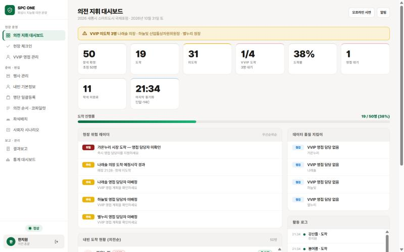
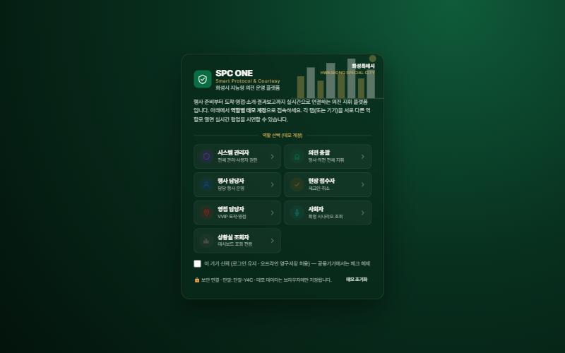
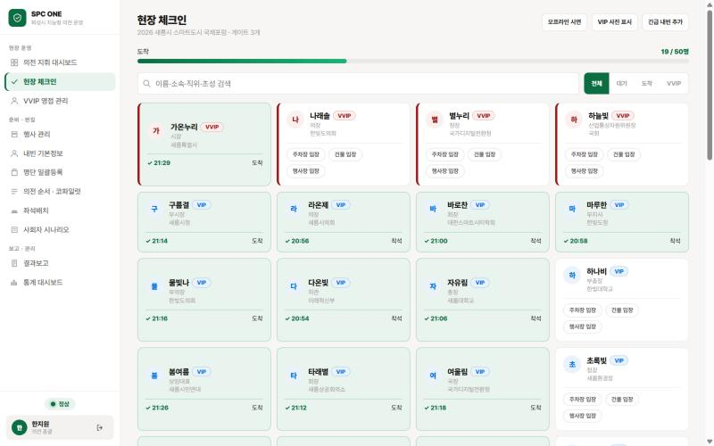
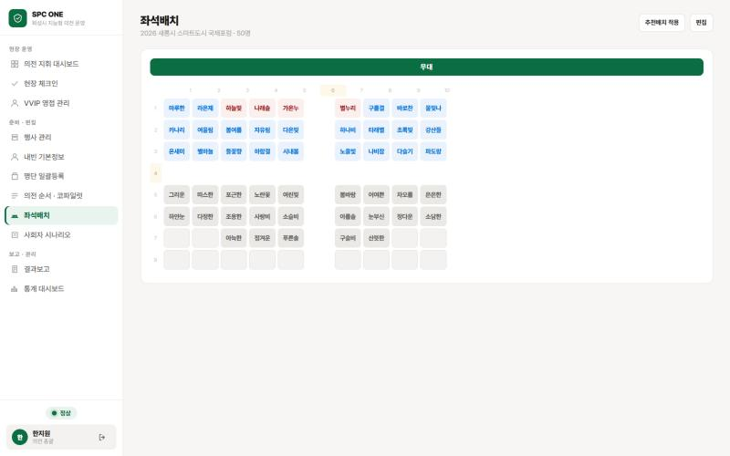
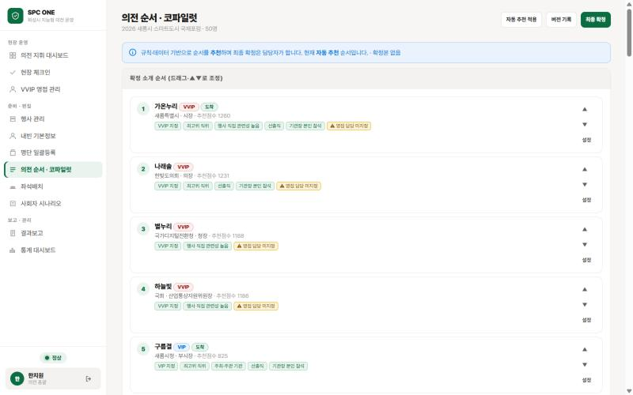
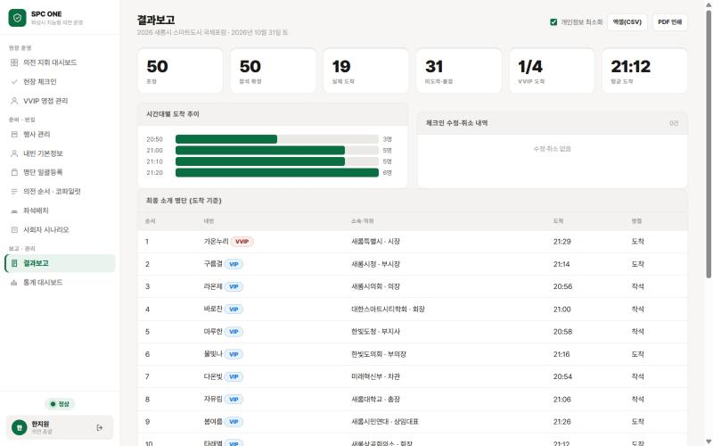

# SPC ONE · 화성시 지능형 의전 운영 플랫폼

> **Smart Protocol & Courtesy ONE** — 행사 준비부터 내빈 도착·영접·소개·결과보고까지 한 화면에서 실시간으로 지휘하는 의전 운영 웹앱

[](https://meistershin.github.io/spcone/)
-555)




- **라이브 데모:** https://meistershin.github.io/spcone/ (로그인 화면에서 역할을 골라 바로 체험)
- **저장소:** [GitHub `MeisterShin/spcone`](https://github.com/MeisterShin/spcone) · [공공 GitLab `hwanchulshin/spc_one`](https://gitlab.aigov.go.kr/hwanchulshin/spc_one)

---

## 왜 만들었나

시청 행사 의전은 아직도 **엑셀 명단·종이 좌석표·무전·전화**로 운영되는 경우가 많습니다. 그러다 보니 현장에서 같은 문제가 되풀이됩니다.

| 현장의 문제 | SPC ONE의 해결 |
|---|---|
| VVIP가 도착했는데 영접 담당자가 모름 | 체크인 즉시 영접 담당자·총괄에게 **도착 알림**, 미지정 시 **위험 레이더** 경보 |
| 누가 왔는지 상황실이 실시간으로 모름 | 접수·영접·상황실이 **같은 화면을 실시간 공유**(탭·기기 간 동기화) |
| 사회자 소개 순서가 도착 현황과 어긋남 | 도착 기준으로 **소개 순서·시나리오 초안 자동 갱신**, 확정본은 버전관리 |
| 내빈 의전 순서를 매번 사람이 정함 | **의전 코파일럿**이 직위·관련성·도착 여부로 순서를 추천하고 **근거를 표시**(최종 확정은 담당자) |
| 행사 후 결과보고서 작성에 반나절 | 도착 추이·명단·수정이력을 담은 **결과보고 자동 생성**(PDF·엑셀) |
| 현장 와이파이가 끊기면 접수 중단 | **오프라인 체크인** 후 재연결 시 중복 없이 자동 동기화 |

## 화면

| 로그인(역할 선택) | 현장 체크인(동선 게이트) |
|---|---|
|  |  |
| **좌석배치(자동 추천·끌어놓기)** | **의전 순서 · 코파일럿(추천 근거)** |
|  |  |
| **결과보고 자동 생성** | **의전 지휘 대시보드** |
|  |  |

> 화면의 인물·기관은 모두 **가상 데이터**입니다(실명 사용 금지 원칙).

## 주요 기능

### 행사 당일 — 현장 운영
- **의전 지휘 대시보드** — 참석·도착·VVIP 도착·영접 대기·착석 지표, 현장 위험 레이더(VVIP 지연·영접 미배정), 데이터 품질 지킴이, 활동 로그, 연결 상태
- **현장 체크인** — 이름·소속·직위·**초성 검색**, VVIP·동명이인 **확인 단계**, 중복 클릭 방지, **5초 실행취소**, 도착시각 수정·취소(이력 보존)
- **동선 게이트** — 주차장 → 건물 → 행사장처럼 여러 지점 통과 기록, 앞 게이트를 건너뛰면 확인창, 마지막 게이트 통과 = 도착
- **진행 단계 관리** — 도착 → 영접 완료 → **착석 → 퇴장**, 미도착 내빈 **불참 처리**(불참자는 경보·좌석배치에서 자동 제외)
- **VVIP 영접 관리** — 도착 알림, 지연 경보, 영접 담당 지정·완료 처리, 차량번호·주차 위치, 수행원 명단, 확인용 사진 표시
- **오프라인 체크인** — 네트워크가 끊겨도 기기에 저장 → 재연결 시 멱등(중복 없는) 동기화

### 행사 전 — 준비·편집
- **행사·내빈 관리** — 내빈 기본정보(소속·직위·등급·발음·차량), 행사별 배정(기존 체크인 기록을 보존하는 차이 반영 방식)
- **명단 일괄등록** — 엑셀에서 복사한 명단을 붙여넣어 한 번에 등록, 동명이인 탐지
- **의전 순서 · 코파일럿** — 규칙 기반 추천 + **추천 근거 표시**, 끌어놓기·▲▼ 수동 조정
- **좌석배치** — 무대 기준 중앙·앞줄 우선 자동 배치, 복도 행·열 지정, 끌어놓기(PC)·탭 이동(모바일)
- **사회자 시나리오** — 도착 기준 초안 자동 갱신, 확정본 **버전관리**, 발표 모드(큰 글씨·발음 안내), 사회자 새 버전 수락

### 행사 후 — 보고·분석
- **결과보고** — 시간대별 도착 추이·평균 도착·수정/취소 이력·최종 소개 명단 자동 생성, **PDF 인쇄·엑셀(CSV)**, 개인정보 최소화 버전
- **통계 대시보드** — 행사별 참석률·도착 분포·VVIP 응대시간, 행사 간 참석률·응대완료율 추이

## 역할과 권한

접속하면 7개 역할 중 하나를 고릅니다. **서로 다른 탭·기기를 다른 역할로 열면 실시간 협업을 시연**할 수 있습니다.

| 역할 | 할 수 있는 일 |
|---|---|
| 시스템 관리자 | 전체 관리·사용자 권한·행사 삭제 |
| 의전 총괄 | 행사·내빈·의전순서·시나리오·영접 전체 |
| 행사 담당자 | 담당 행사 운영·배정·시나리오 확정 |
| 현장 접수자 | 체크인·취소 |
| 영접 담당자 | VVIP 도착 알림·영접 완료 |
| 사회자 | 확정 시나리오·발표 모드(비공개 정보 미노출) |
| 상황실 조회자 | 대시보드·보고 조회 전용 |

## 빠르게 써 보기

1. [라이브 데모](https://meistershin.github.io/spcone/)를 열거나, 저장소를 내려받아 `spc.html`을 브라우저로 엽니다(설치·서버 불필요).
2. **의전 총괄**로 로그인 → 대시보드에서 VVIP 미도착·위험 레이더를 확인합니다.
3. 다른 탭을 **현장 접수자**로 열어 체크인하면, 첫 탭 대시보드가 실시간으로 바뀝니다.
4. 체크인 화면의 **오프라인 시연** 버튼으로 끊김 → 재연결 동기화를 보여 줄 수 있습니다.
5. 로그인 화면 오른쪽 아래 **데모 초기화**로 언제든 처음 상태로 되돌립니다.

> ⚠️ 라이브 데모는 여러 사람이 같은 데이터를 공유할 수 있는 시연 환경입니다. **실제 개인정보를 입력하지 마세요.**

## 구조

```
┌──────────────── spc.html (단일 파일) ────────────────┐
│ 화면: 대시보드 · 체크인 · 영접 · 내빈 · 순서 · 좌석 · │
│       시나리오 · 발표 · 결과보고 · 통계              │
│ 엔진: 체크인 트랜잭션 · 오프라인 큐 · 코파일럿 추천 · │
│       위험 레이더 · 품질 지킴이 · 감사기록            │
└───────────────┬─────────────────────┬───────────────┘
        브라우저 localStorage     (선택) Firebase Firestore
        + BroadcastChannel        다기기 실시간 동기화
        (같은 브라우저 탭 간)
```

- **기본은 로컬 모드**: 데이터는 브라우저에 저장되고, 같은 브라우저의 탭끼리 실시간 공유됩니다.
- **클라우드 모드**: `spc.html` 위쪽 `FB_CONFIG`에 Firebase 웹 설정을 넣으면 Firestore로 여러 기기가 실시간 연결됩니다. 절차는 [`배포가이드_GitHubPages_Firebase.md`](배포가이드_GitHubPages_Firebase.md)를 참고하세요.
  - 공공 GitLab 사본은 보안검사 정책에 따라 키가 `YOUR_FIREBASE_API_KEY`로 비워져 있어 로컬 모드로 동작합니다.
- **설계 원칙**: 핵심 업무는 규칙 기반으로 안정 작동하고, 추천(AI)은 보조이며 최종 결정은 담당자가 합니다. 기록은 지우지 않고 상태 변경과 이력으로 남깁니다.

## 배포

| 방식 | 방법 |
|---|---|
| GitHub Pages | 저장소 루트를 Pages로 게시(`.nojekyll` 포함, `index.html`이 `spc.html`로 이동) |
| Firebase Hosting | 포함된 `firebase.json`으로 `firebase deploy` |
| Netlify 등 정적 호스팅 | 폴더 전체를 업로드(`_redirects.txt` 포함) |
| 오프라인 단독 | `spc.html` 파일 하나를 PC·태블릿에서 열기 |

## 검증

```bash
node tests/run.js
```

브라우저 없이 앱 스크립트를 격리 환경에서 불러와 **108개 항목**을 검사합니다(2026-10-31 기준 전부 통과).
- 배정 변경 시 기존 체크인 보존, 체크인 중복 방지·멱등, 오프라인 큐 무손실 동기화, 취소 이력 보존
- 전 역할 × 전 화면 렌더 오류 없음, 권한별 차단
- 좌석 자동배치·이동, 동선 게이트, 수행원, 통계, 클라우드 동기화 경로
- 행사일 기준 시각 계산, 착석·퇴장·불참 전환, 게이트 건너뜀 확인

## 실제 운영 전에 필요한 일 (알려진 한계)

이 저장소는 **경진대회·시연용 시제품**입니다. 실제 행사에 쓰려면 아래를 먼저 보완해야 합니다.

1. **인증** — 지금은 비밀번호 없이 역할을 고르는 데모 로그인입니다. 개인별 계정(기관 SSO 또는 Firebase Auth)과 서버 측 역할 부여가 필요합니다.
2. **클라우드 보안 규칙** — Firestore를 쓸 경우 역할 기반 Security Rules 배포가 필수입니다(설계는 이관설계서 참고).
3. **동시 수정 보호** — 여러 기기가 같은 내빈을 동시에 고칠 때 필드 단위 저장·버전 비교가 필요합니다.
4. **개인정보** — 연락처·차량번호·사진의 보존기간과 파기 절차를 정해야 합니다.

확장 구조(React + Firestore)는 [`SPC_ONE_React_Firebase_이관설계서.md`](SPC_ONE_React_Firebase_이관설계서.md)에 정리되어 있습니다.

## 파일 구성

```
spc.html                              앱 본체(화면·로직·디자인 전부)
index.html · .nojekyll                GitHub Pages 진입점
firebase.json · _redirects.txt        정적 호스팅 설정
tests/run.js                          로직 검증(node tests/run.js)
docs/images/                          README 화면 캡처
docs/superpowers/                     기능별 설계·구현 계획 기록
DESIGN-notion.md                      디자인 시스템(색·글꼴·간격·컴포넌트)
SPC_ONE_React_Firebase_이관설계서.md  대규모 확장 설계
배포가이드_GitHubPages_Firebase.md    실시간 배포 절차
CLAUDE.md                             개발 지침(AI 코딩 도구용)
spc_v4_backup_20260722.html           개선 전 원본(참고용)
```

## 만든 곳

화성특례시 AI스마트전략실 빅데이터팀 — 공공 행사 의전 업무의 디지털 전환(AX) 시제품
